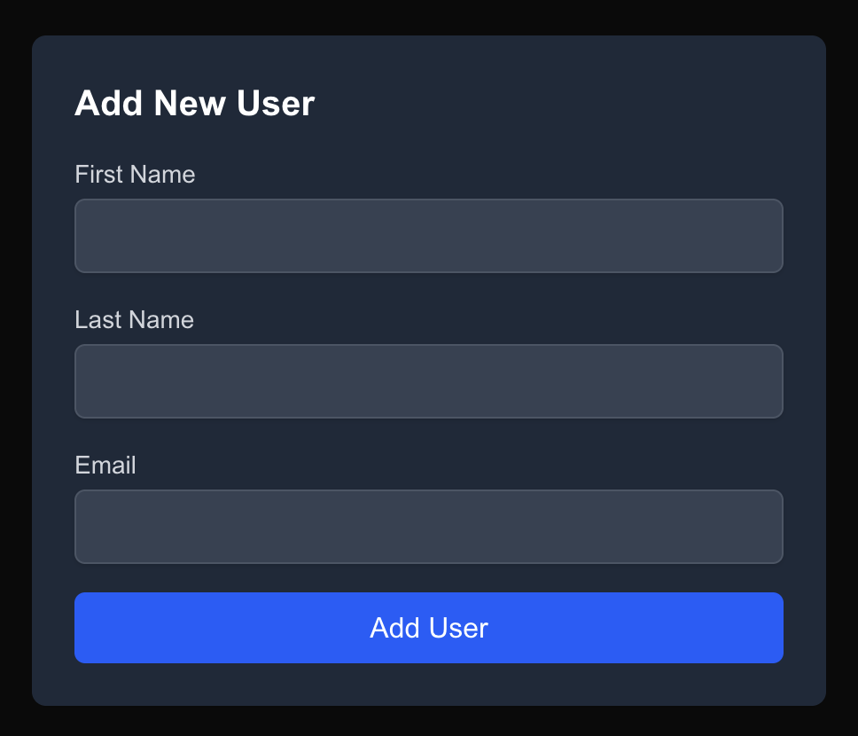
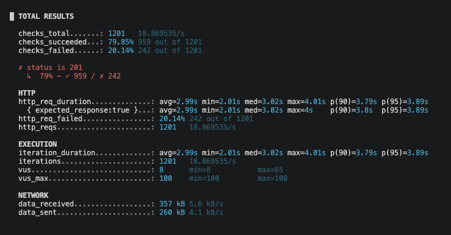
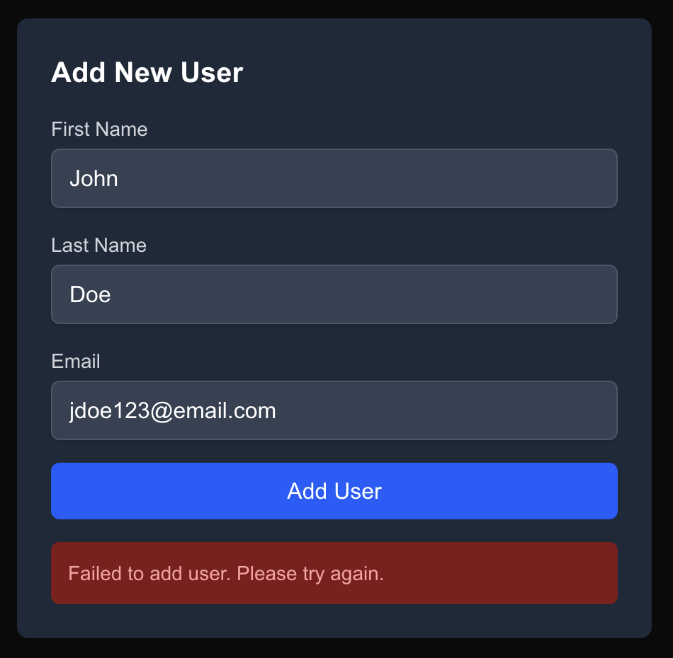
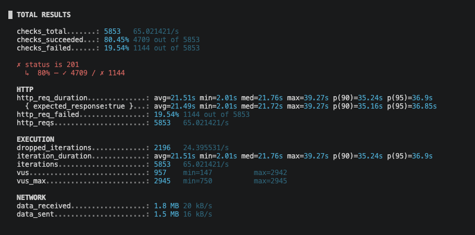
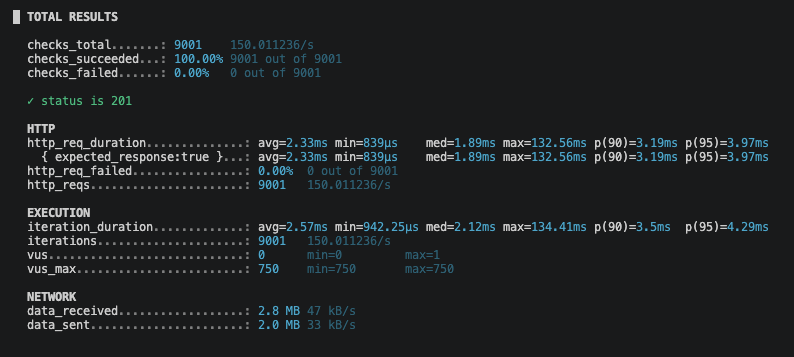
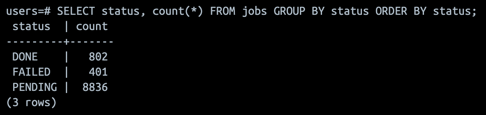

# Moving Slow Work Out of the Request Path With a Job Queue

So far in this series we've focused on patterns inside the Next.js app itself: caching, data fetching and configuration. In this segment I'm shifting focus to system design across the full stack, and this post is all about queues.

The plan is simple: build a signup flow that is deliberately under-engineered, measure how it breaks, then fix it by moving the welcome email to a background job queue.

## The Setup

This post is part of my Next.js Enterprise Patterns series, where we explore real-world patterns for building scalable, production-ready applications. If you want to follow along with hands-on examples, head over to https://github.com/edodso2/nextjs-spring-boot-enterprise-patterns and clone the repository. Follow the repo README to get both the backend and frontend up and running locally.

The code for this post lives on the [`spring-background-jobs-outbox`](https://github.com/edodso2/nextjs-spring-boot-enterprise-patterns/tree/spring-background-jobs-outbox) branch, with one commit per stage so you can check out each version and run the experiments yourself.

The domain is a user signup. A user submits a name, email and password. The system creates the account and sends a welcome email. Account creation is the core action; the email is a slow side effect. That distinction is the whole point of this post.

Here are the pieces:

| Component | Role |
| --- | --- |
| Signup API (Spring Boot) | Accepts `POST /signup`, validates input, creates the user |
| Relational database | Stores users, and later doubles as the job queue |
| Fake email service | Simulates a real provider with configurable latency and failure rate |
| Worker | Pulls jobs from the queue and sends emails |
| Load-testing tool (k6) | Generates signup traffic and reports latency and error rates |

Here's the signup form in the Next.js app:



### The Fake Email Service

The fake email service is the most important piece of this project. Real email providers are slow and occasionally fail, and we need to be able to dial that up and down on demand. It has two settings:

- **Latency**: starts at 2 to 4 seconds per send
- **Failure rate**: starts at 20%

It also logs every send, which makes it easy to spot failures and duplicate emails.

```java
@PostMapping
    public ResponseEntity<Map<String, String>> send(@RequestBody SendEmailRequest request) throws InterruptedException {
        Thread.sleep(ThreadLocalRandom.current().nextLong(MIN_LATENCY_MS, MAX_LATENCY_MS + 1));

        if (ThreadLocalRandom.current().nextDouble() < FAILURE_RATE) {
            log.warn("FAILED to={}", request.to());
            throw new ResponseStatusException(HttpStatus.SERVICE_UNAVAILABLE, "Simulated provider failure");
        }

        String messageId = UUID.randomUUID().toString();
        log.info("SENT messageId={} to={} subject=\"{}\"", messageId, request.to(), request.subject());
        return ResponseEntity.status(HttpStatus.ACCEPTED).body(Map.of("messageId", messageId));
    }
```

## Stage 1: The Under-Engineered Version

> Code: [stage 1 - under engineered](https://github.com/edodso2/nextjs-spring-boot-enterprise-patterns/commit/f324117be993838ed5a4536353235697aaba4e53)

The first version of the signup endpoint does everything inline. This is how a lot of signup flows start out, and honestly it works fine on your laptop:

```
validate input
insert user (commit)
call email service and wait   <- 2-4s, fails 20% of the time
return 201
```

```java
public User createUser(CreateUserRequest request) {
    User user = userRepository.save(User.from(request));
    emailClient.sendWelcomeEmail(user);
    return user;
}
```

Now let's see how it holds up.

### Experiment 1: Latency Held Hostage

First we'll load test the signup endpoint at 20 to 50 requests per second using [k6](https://k6.io). k6 tests are plain JavaScript scripts, so they're easy to write, and they also fit nicely into a CI/CD pipeline to catch latency regressions before they ship.

The script below starts a fixed number of new signups every second (20 by default) for 60 seconds, no matter how slow the responses are. That's what makes it a fair test: if the API slows down, k6 doesn't back off, it just spins up more virtual users to keep the rate steady, the same way real users would keep arriving. Each request uses a unique email so the signups don't collide, and we check that every response comes back `201 Created`.

```JavaScript
import http from 'k6/http';
import { check } from 'k6';

const RATE = Number(__ENV.RATE || 20);
const BASE_URL = __ENV.BASE_URL || 'http://localhost:8080';

export const options = {
  scenarios: {
    signups: {
      // Starts RATE new signups every second, however slow the responses are
      executor: 'constant-arrival-rate',
      rate: RATE,
      timeUnit: '1s',
      duration: __ENV.DURATION || '60s',
      preAllocatedVUs: RATE * 5,
      maxVUs: RATE * 20,
    },
  },
};

export default function () {
  // Unique email per request so signups don't collide with each other
  const id = `${Date.now()}-${__VU}-${__ITER}`;
  const res = http.post(
    `${BASE_URL}/api/users`,
    JSON.stringify({ email: `load-${id}@example.com`, firstName: 'Load', lastName: 'Test' }),
    { headers: { 'Content-Type': 'application/json' } },
  );
  check(res, { 'status is 201': (r) => r.status === 201 });
}
```

Run it with:

```bash
k6 run load-tests/signup.js
```



The results line up almost exactly with the fake email service settings:

- **Latency**: p95 is 3.89s, with a min of 2.01s and a max of 4.01s. That's the 2 to 4 second email latency plus a few milliseconds of actual signup work.
- **Errors**: 20.14% of requests failed (242 of 1201), which is the email service's 20% failure rate passing straight through to our users.

Our signup is now exactly as fast, and exactly as reliable, as our slowest dependency. The user sits on a spinner for 2 to 4 seconds waiting on an email they don't need yet, and one in five times they get an error for it.

Also notice the `vus` line. k6 needed up to 65 virtual users to keep 20 signups per second going, because each one is stuck waiting about 3 seconds for a response. Keep that in mind; it comes back in Experiment 3.

### Experiment 2: Half-Done Signups

Experiment 1 was about speed. This one is about correctness.

Stop the email service, then open the UI at http://localhost:3000/users and try to create a new user. The request fails with a 500:



Here's what actually happened. The user row was inserted and committed *before* we called the email service. The email call failed, and the API returned a 500, but the account already exists.

The UI tells the user to try again, so they do. This time the request fails because the email is already taken. The user is now stuck: as far as they can tell signup never worked, but they can't sign up again with that email either.

The 500 is lying to the user. Account creation, the thing they actually asked for, succeeded. The welcome email, a side effect that could have been sent a few seconds later, decided the response. The same thing happened to the 242 "failed" signups in Experiment 1. Every one of those accounts was created.

### Experiment 3: Resource Exhaustion

Now let's see how much traffic the API can take before it falls over. Same script, higher rate:

```bash
k6 run -e RATE=150 load-tests/signup.js
```

Spring Boot's embedded Tomcat server has 200 request threads by default, and each signup holds one for about 3 seconds while it waits on the email service. That puts the ceiling at roughly 200 / 3 ≈ 66 requests per second.



We asked for 150 signups per second and got 65. The rest waited in line for a free thread, pushing p95 from 3.89s to **36.9s**, and k6 dropped another 2,196 signups it couldn't even start. The error rate stayed at 20% only because nothing timed out, but nobody is waiting 37 seconds on a signup form.

### Stage 1 Baseline

| Metric | Stage 1 |
| --- | --- |
| p95 latency (20 req/s) | 3.89s |
| Error rate | 20.14% |
| Max throughput | ~65 req/s |

## Why Not Just Scale It?

Here's the interesting part of Experiment 3: while the API was falling over, CPU and memory would have looked fine. The threads weren't working, they were waiting. A blocked thread uses almost no CPU, so every hardware dashboard says the service is healthy while users stare at a spinner.

That's [Little's Law](https://en.wikipedia.org/wiki/Little%27s_law) in action: **concurrent requests = throughput × latency.** With 200 threads and 3 seconds per request, 66 req/s is the most we'll ever get. A bigger container doesn't change either number.

It also means the usual autoscaling setup won't save you. If you scale on CPU, which is the common default, you'll never add a container, because CPU stays low the whole time the service is failing.

### More Containers

Horizontal scaling does work, in a sense. Each new container adds about 66 req/s. But look at what it actually fixes:

- **Latency:** still 3 to 4 seconds per signup.
- **Half-done signups:** still broken. If the email fails, the user still gets a 500 for an account that exists.
- **Exhaustion:** fixed, but now we're paying for a fleet of containers that mostly sit around waiting.

And we've pushed the problem downstream. Ten containers can make ten times as many concurrent calls to the email provider, and real providers rate-limit. We can scale our side; we can't scale theirs.

### Retries

Retrying the email inside the request makes things worse, not better. Each retry adds another 2 to 4 seconds of holding a thread, so a single retry roughly halves our ceiling to about 33 req/s. And when the provider is already struggling, every API instance hammering it with retries is exactly how you get a retry storm.

### Band-Aids

If you can't add a queue today, a few things will help in the short term:

- **Timeouts:** give up on the email call after 500ms instead of waiting 4 seconds.
- **Bulkheads:** cap how many requests can call the email service at once, so the rest of the API keeps its threads.
- **Circuit breakers:** when the email service keeps failing, stop calling it for a while and fail fast.
- **Virtual threads:** on Java 21+, `spring.threads.virtual.enabled=true` makes waiting threads nearly free and mostly removes the 200-thread ceiling.

These are all worth knowing, but none of them fix the real problem: **a side effect is deciding the outcome of the core action.** As long as the email is in the request path, its latency is our latency and its failures are our failures. You might be tempted to reach for `@Async` and fire off the email in the background, but that's really just an in-memory queue that loses every pending email when the app restarts.

What we actually want is to get the email out of the request entirely, and to do it without losing any.

## Stage 2: Fix It With a Queue

> Code: [stage 2 - queue](https://github.com/edodso2/nextjs-spring-boot-enterprise-patterns/commit/5e239c250200570ba61d2ddf6179f57bcf747c5d)

The fix is to keep user creation synchronous and move the email to a background job. The user needs to know their account exists before we respond; they don't need the email to have been sent.

We don't need to add Kafka or RabbitMQ for this. The database we already have makes a perfectly good job queue: a `jobs` table that workers claim using row locking that skips already-locked rows.

```sql
CREATE TABLE jobs (
    id          BIGSERIAL PRIMARY KEY,
    type        VARCHAR(50) NOT NULL,
    user_id     BIGINT NOT NULL REFERENCES users(id),
    status      VARCHAR(20) NOT NULL DEFAULT 'PENDING',
    created_at  TIMESTAMP NOT NULL DEFAULT now()
);
```

### The Outbox Pattern

The important detail is that the user and the job are written **in the same transaction**:

```
BEGIN
  insert user
  insert job (type = welcome_email, user_id)
COMMIT
```

<!-- TODO: swap in the real Stage 2 service from the repo -->
```java
@Transactional
public User createUser(SignupRequest request) {
    User user = userRepository.save(User.from(request));
    jobRepository.save(Job.welcomeEmail(user.getId()));
    return user;
}
```

This is the outbox pattern. Either both rows commit or neither does, so we can never end up with a user that has no email job, or an email job for a user that doesn't exist. If we wrote the user and then enqueued the job as a separate step, a crash in between would silently drop the email. That's the dual-write problem, and the outbox pattern prevents it.

### The Worker

A separate worker process polls for pending jobs, sends the email and marks the job done. The key is how it claims jobs:

<!-- TODO: swap in the real query from the repo -->
```sql
SELECT * FROM jobs
WHERE status = 'PENDING'
ORDER BY created_at
LIMIT 10
FOR UPDATE SKIP LOCKED;
```

`FOR UPDATE` locks the rows so no other worker can grab them, and `SKIP LOCKED` tells other workers to skip those rows instead of waiting on them. That lets us run several workers against the same table without them stepping on each other.

<!-- TODO: swap in the real worker code from the repo -->
```java
@Scheduled(fixedDelay = 500)
@Transactional
public void processJobs() {
    List<Job> jobs = jobRepository.claimPendingJobs(10);
    for (Job job : jobs) {
        emailClient.sendWelcomeEmail(job.getUserId());
        job.markDone();
    }
}
```

### Rerunning the Experiments

Now run the same 150 req/s load test that took down Stage 1:

```bash
k6 run -e RATE=150 load-tests/signup.js
```



Every one of the 9,001 signups returned `201`, and p95 dropped from 36.9 **seconds** to 3.97 **milliseconds**. The request only does two inserts and returns. k6 never needed more than a single virtual user, because each response comes back before the next request is even due.

The 20% error rate is gone too. The email service is still failing one in five sends, but now that only affects the worker, not the user.

Then stop the email service entirely and run it again. Signups keep working. Jobs pile up in the `jobs` table, and once the email service comes back the worker drains them.



| Metric | Stage 1 | Stage 2 |
| --- | --- | --- |
| p95 latency (150 req/s) | 36.9s | 3.97ms |
| Error rate (150 req/s) | 19.54% | 0% |
| Throughput (150 req/s requested) | ~65 req/s | 150 req/s |
| Signups with email service down | 0% | 100% |

## What We Haven't Solved Yet

The queue fixed latency, availability and the half-done signups, but our worker is still pretty naive. Here's what it needs before it's production-ready:

- **Worker crashes mid-send.** The job's transaction rolls back, the job runs again and the user gets two emails. Queues deliver *at least once*, so consumers need to be idempotent. Record each send in a table with a unique constraint on `(user_id, email_type)`, or pass an idempotency key to the email provider.
- **No retries.** With a 20% failure rate, one in five jobs just fails. Add an attempt count and a next-run time, and retry with exponential backoff.
- **Poison messages.** An address the provider always rejects will retry forever. After N attempts, mark the job as failed (your dead-letter queue) and add a way to inspect and re-run failed jobs.
- **No visibility.** If the worker stops, the queue silently backs up. Expose queue depth and oldest-job age so you can alert on them, and scale workers when the backlog grows. `SKIP LOCKED` already makes it safe to run several workers side by side.

## Closing Thoughts

The rule I took away from this one: **the core action stays synchronous, side effects become jobs.** If the user needs the result to continue, do it in the request. If it can happen a few seconds later, it belongs on a queue.

And you don't need new infrastructure to start. A `jobs` table, `SKIP LOCKED` and writing the job in the same transaction as the data gets you a long way, and you get transactional enqueue for free, which is something a dedicated queue system can't give you.
